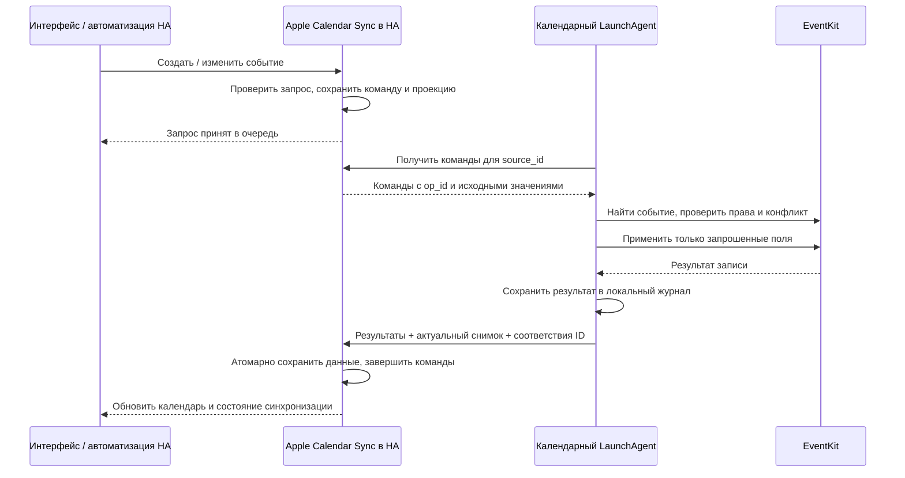

# План: создание и редактирование календарных событий из Home Assistant

Статус: проект решения, без реализации. Дата: 2026-10-02.

## 1. Результат для пользователя

В существующей интеграции Apple Calendar Sync пользователь выбирает календарь,
создаёт событие или редактирует существующее в Home Assistant. Изменение попадает
в исходный календарь на Mac; дальнейшую синхронизацию с iCloud, Google, Exchange
или другим подключённым аккаунтом выполняет macOS.

Сохраняются одна интеграция в HA, отдельная сущность для каждого календаря,
нативный помощник EventKit, Python 3.9 без сторонних зависимостей и отдельный
календарный LaunchAgent. На Mac не появляется HTTP-сервер и не нужны входящие
соединения. Напоминания и батареи продолжают работать независимо.

Обязательный объём:

- Создание обычного события в выбранном доступном для записи календаре.
- Редактирование названия, описания, места, начала, окончания и признака
  «весь день», включая перенос во времени.
- Изменения из Calendar.app продолжают отображаться в HA.
- Сохранение запросов при недоступном Mac, повторные попытки без дубликатов,
  понятные статусы ошибок и конфликтов.
- Корректная адресация повторяющихся событий; нельзя случайно изменить всю
  серию вместо выбранного экземпляра.

Создание повторяющихся событий включить после реализации и тестирования
поддерживаемого набора RRULE. Неподдерживаемое правило явно отклонять.
Удаление событий — следующий отдельный этап: протокол предусмотреть сразу,
но DELETE_EVENT не включать автоматически вместе с созданием и редактированием.
Создание календарей, перенос события между календарями, управление участниками,
приглашениями, вложениями и напоминаниями не входят в первую версию.

Календари только для чтения остаются видимыми. Возможность записи определяется
реальными правами EventKit, а не названием провайдера. В доступном для записи
календаре отдельное приглашение всё равно может не разрешать нужную операцию:
это должно возвращаться как ошибка, а не превращаться в новую копию события.

## 2. Что уже есть и что требуется изменить

| Сейчас | Требуется |
| --- | --- |
| `native/CalendarExport.swift` только экспортирует | Добавить структурированные команды чтения, поиска и записи |
| UID = `calendarItemIdentifier + текущий startDate` | Устойчивая идентичность события/серии и отдельный идентификатор экземпляра |
| Один POST полного снимка Mac → HA | Очередь HA → Mac, результаты выполнения и согласованные снимки |
| `_attr_supported_features = 0` | CREATE_EVENT и UPDATE_EVENT только при подтверждённой поддержке |
| HA хранит только снимки | Снимки, очередь операций, результаты и версии протокола |
| На Mac нет календарного состояния | Отдельный журнал выполнения и соответствий идентификаторов |
| Любой новый снимок заменяет предыдущий | Старый снимок не отменяет ожидающие изменения и не откатывает подтверждённые |

Главный дефект текущего UID: перенос начала события выглядит как смена его
идентичности. До добавления записи этот формат необходимо заменить с миграцией;
изменение календарных UID не должно менять unique_id существующих calendar entities.

## 3. Архитектура и поток данных

Принятое архитектурное решение: HA хранит намерения пользователя, EventKit —
фактические события. Mac регулярно забирает команды по существующему исходящему
соединению к HA. Отдельного постоянно работающего демона не требуется.

При стандартном интервале задержка составляет до одного интервала плюс время
работы EventKit и провайдера. Пауза сна Mac увеличивает задержку. Успешная запись
в локальный EventKit означает «применено на Mac»; обещать подтверждение от
удалённого сервера Google/iCloud на этом основании нельзя.

## 4. Обязательное исследование перед кодом основной функции

Провести небольшой эксперимент в специально созданном локальном тестовом
календаре и dev HA на :8124. Рабочие календари не использовать.

1. Проверить фактические аргументы `async_create_event` и `async_update_event`
   в поддерживаемой версии HA, а также поведение стандартного редактора.
2. Проверить идентификаторы обычного события после переноса, события серии,
   отделённого экземпляра, разделения серии и обновления аккаунта.
3. Проверить возможность найти экземпляр по исходной дате повторения после
   переноса, в том числе вне обычного окна экспортирования.
4. Проверить `.thisEvent` и `.futureEvents`, а также изменение всей серии,
   включая её историю и уже изменённые экземпляры. Нет прямого EKSpan «вся серия»:
   работу с первым экземпляром нельзя объявлять эквивалентной без проверки.
5. Проверить, когда появляется EventKit ID нового события и можно ли надёжно
   восстановить результат после сбоя между `save` и записью локального журнала.
6. Проверить TCC для подписанного помощника при запуске вручную и через launchd.
7. Зафиксировать минимальные версии macOS/HA и проверенную матрицу операций.

Результат этапа: контракт идентичности и таблица поддерживаемых операций, включая
явно неподдерживаемые варианты. Это условие перехода к реализации редактора.

## 5. Идентичность и схема данных v2

### Календари

Продолжать адресовать календарь парой `(source_id, calendar_id)` и сохранять
существующие unique_id сущностей HA. Добавить `writable`, при возможности —
часовой пояс аккаунта и набор проверенных возможностей записи. Названия не
использовать как ключи. Не объединять автоматически одинаковые аккаунты с разных
Mac: для одного календаря запись выполняет только тот Mac, которому принадлежит
выбранная сущность HA.

### События

Разделить:

- `uid`: стабильный публичный ID обычного события или серии в рамках календаря;
- `recurrence_id`: исходная дата/время экземпляра, а не его новое начало;
- `event_identifier`, `calendar_item_identifier`, `external_identifier`:
  внутренние подсказки для поиска в EventKit;
- `revision`: хеш нормализованных редактируемых значений;
- `timezone`: IANA timezone для событий с временем и повторений;
- `recurring`, сведения о правилах повторения и отделённых экземплярах.

Окончательный способ формирования стабильного uid выбрать по эксперименту.
Рекомендуется собственное соответствие публичных ID и нескольких EventKit ID.
Локальный ID не считать вечным, внешний — глобально уникальным. Резервный поиск
всегда ограничивать календарём и проверять однозначность. Не усыновлять события
по одному названию или близкому времени.

`occurrenceDate` использовать как основу recurrence_id: Apple описывает её как
исходную дату экземпляра, сохраняющуюся после отделения и переноса.
Для all-day это плавающая календарная дата; для timed — однозначная дата/время
с сохранённым контекстом timezone. Преобразование проверить на DST.

### Операция очереди

Минимальные поля: `op_id`, `source_id`, `calendar_id`, `kind`, `uid`,
`recurrence_id`, `scope`, `patch`, `base_values`, `base_revision`,
`created_at`, `sequence`, `status`, `attempts`, `result`, `error_code`.
Для create target UID ещё нет: HA выдаёт временный UID, а результат содержит
соответствие временному и постоянному ID.

Patch различает отсутствие поля и явное очищение. Отсутствующее описание/место
не менять; явное пустое значение очищает. Не передавать полную экспортированную
копию события вместо patch: это может уничтожить невидимые в HA свойства.

Статусы: `queued`, `leased`, `applied`, `conflict`, `failed`, `outcome_unknown`.
Терминальные результаты хранить до подтверждения обеими сторонами и затем
очищать по ограниченной политике хранения. Недоставленную команду не удалять
только потому, что истёк произвольный срок.

## 6. Протокол обмена

Предлагаемые маршруты под `/api/apple_calendar_sync`:

| Маршрут | Назначение |
| --- | --- |
| `POST /exchange` | Версия клиента, source_id, локальные результаты, снимок и запрос следующей пачки команд |
| `GET /status` | Диагностика очереди и последних результатов; без выдачи чужих операций |

Существующий `POST /snapshot` сохранить для старых клиентов. Новый `/exchange`
должен атомарно сохранять на стороне HA подтверждения, соответствия ID и снимок.
Не допускать ситуации «команда завершена, а снимок до её выполнения».

Обмен выполняется в два прохода одного запуска: получить команды; применить;
повторно прочитать EventKit; отправить результаты и снимок. Повторная доставка
того же op_id возвращает ранее сохранённый результат. Lease позволяет вернуть
команду в очередь после потери клиента, но не заменяет защиту от повторной записи.

Добавить последовательный номер поколения снимка и блокировку одного
календарного запуска на Mac. Старые или одновременно доставленные снимки
отклонять. Для записанного результата события включать адресный read-back даже
вне стандартного окна; обычный снимок всё ещё имеет конечный диапазон.

Ограничить размер пачки и общий размер очереди. Переполненный запрос явно
отклонять до ответа об успехе. Команды с отказом доступа не повторять в плотном
цикле; сетевые сбои повторять с ограниченным backoff.

Авторизация остаётся через существующий HA token. Источники не могут забирать
команды друг друга по ошибке фильтрации source_id. Административное требование
для обмена можно сохранить в первом релизе; вызовы CalendarEntity должны
сохранять обычную проверку прав пользователя HA на выбранную сущность.

## 7. Выполнение и защита от дубликатов

На Mac добавить отдельный `calendar.state_file`, например
`~/.local/state/reminders-ha-sync/calendars.json`. Он не связан с `state.json`
напоминаний и `batteries.json`. Хранить соответствия идентификаторов, журнал
операций и последний подтверждённый exchange; запись атомарная, права 0600.
Журнал должен вести процесс, выполняющий EventKit write, чтобы Python не
создавал дополнительное окно между завершением helper и сохранением результата.

Порядок операции:

1. Проверить журнал op_id: готовый результат вернуть без повторной записи.
2. Найти актуальный календарь и событие, проверить права и исходные значения.
3. Надёжно сохранить намерение выполнить операцию.
4. Вызвать EventKit save; после успеха перечитать данные.
5. Надёжно сохранить результат и новые ID, затем вернуть его Python.
6. Передать результат HA; подтверждённые команды больше не выполнять.

EventKit и локальный журнал не образуют общей транзакции. Поэтому нельзя
обещать exactly-once только за счёт op_id. После crash между save и журналом:

- Если результат однозначно восстанавливается по сохранённому ID и свежим
  данным, записать найденный результат без нового save.
- Если создание нельзя однозначно подтвердить, присвоить `outcome_unknown`,
  остановить автоматический повтор и предложить сверку через диагностику.
- Не искать созданное событие по названию и не повторять create наугад.
- Не добавлять служебные маркеры в пользовательские notes/URL без отдельного
  решения; это изменяет данные пользователя.

Обновление только изменённых полей тоже не всегда безопасно повторять:
после первого применения пользователь мог снова изменить их на Mac. Повторять
только при доказанном исходном состоянии либо вернуть прежний результат.
Потеря локального журнала переводит незавершённые операции в сверку, а не в
массовое повторное создание. Потеря Reminders state на этот механизм не влияет.

## 8. Конфликты и сохранение других свойств

Использовать трёхстороннюю проверку: значения, показанные HA при редактировании;
свежие значения EventKit; patch пользователя HA. Для первой версии:

- Если изменяемые поля EventKit совпадают с base_values, применить patch.
- Если уже совпадают с желаемыми значениями, вернуть подтверждённый read-back.
- Изменения Mac в независимых полях сохранить.
- Если обе стороны изменили одно поле по-разному, вернуть `conflict` и свежие
  значения. Не выбирать победителя молча.
- Отсутствующее событие не воссоздавать при update; вернуть `event_missing`.
- Не считать исчезновение из скользящего окна доказательством удаления.

Важно: штатный вызов update HA не обязательно передаёт revision снимка,
который пользователь видел при открытии формы. Поэтому base_values на стороне
интеграции надёжно фиксируют состояние при постановке команды в очередь, но
не доказывают, что сама открытая в браузере форма не устарела. Проверить это
на этапе 1. Если revision формы недоступен, явно ограничить гарантию конфликтов
интервалом «очередь → применение»; для строгой защиты stale-form нужен контракт
редактора с expected_revision, а не выдуманное сервером подтверждение.

Начало, конец, all-day и timezone рассматривать как связанную группу:
независимый merge этих полей может дать неправильный интервал. У серии также
проверять правило повторения и область изменения.

Изменять найденный EKEvent на месте, сохраняя всё, что HA не редактирует:
участников, организатора, alarms, URL, вложения и свойства провайдера. Не заменять
событие через delete/create. Повторно найти/refresh событие непосредственно
перед save: документация Apple предупреждает, что save удалённого объекта может
создать его заново. Между проверкой и save остаётся гонка внешних изменений;
EventKit не предоставляет нам доказанный серверный compare-and-swap. Этот предел
зафиксировать, проверить поведение на удалении и не обещать строгую изоляцию.

На один event/series разрешать одну незавершённую команду в первой версии.
Повторное редактирование до завершения явно отклонять; это проще и надёжнее,
чем неявно объединять patch и цепочки устаревших revisions.

## 9. Повторения: отдельный критерий готовности

HA различает изменение всей серии, отдельного экземпляра и THISANDFUTURE.
EventKit предоставляет `.thisEvent` и `.futureEvents`, поэтому перевод
семантики требует самостоятельной реализации и тестов.

- Обычное событие: обычный update без recurrence_id.
- Экземпляр серии: находить по uid и исходному recurrence_id, применять
  `.thisEvent`, после переноса сохранять прежнюю идентичность экземпляра.
- Экземпляр и последующие: `.futureEvents` после проверки поведения отделённых
  экземпляров; сохранить соответствия после разделения серии.
- Вся серия: разработать и проверить алгоритм поиска исходной серии и
  сохранения исключений. Не сводить запрос к «текущий и последующие».

RRULE из HA нельзя принимать как произвольную строку и молча упрощать при
преобразовании в EKRecurrenceRule. Определить проверенный набор правил;
всё остальное явно отклонять с сохранением исходной серии.

UPDATE_EVENT не включать как обещание полного стандартного редактирования,
пока обязательные для HA варианты повторений не реализованы. Возможен этап
«только create»; ограниченный редактор отдельных экземпляров через собственное
действие — лишь временный вариант и не критерий завершения основной задачи.
Если точный update всей серии средствами EventKit не получается, это блокер
данного сценария: описать ограничение и согласовать изменение объёма, а не
заявлять о полной поддержке.

## 10. Поведение HA и обратная связь

`async_create_event` и `async_update_event` валидируют запрос и сохраняют его в
очередь до возврата управления. Успех этого вызова означает «принято», а не
«уже записано на Mac». Для работающего по расписанию Mac это осознанный компромисс.

В HA показывать проекцию ожидающей операции поверх подтверждённого снимка:
новое событие появляется с временным UID, редактирование видно сразу. Старый
снимок не отменяет эту проекцию. При применении заменить её фактическим read-back;
при конфликте/отказе восстановить актуальные данные и создать постоянное
уведомление либо Repair issue с событием и причиной.

Стандартный интерфейс HA не гарантирует отдельный pending-indicator для
события. Добавить диагностику интеграции: число ожидающих команд, последнее
применение, последний конфликт/ошибка и доступность Mac. Проверить обновление
UI и слушателей календаря даже без смены on/off состояния.

Для offline-редактирования отдельно проверить правила unavailable в HA:
стандартные сервисы и редактор могут запрещать вызовы недоступной сущности.
Предлагаемое изменение для режима записи: известный календарь с валидным
снимком остаётся доступным при сне Mac, а source_online/stale показываются
отдельно в диагностике; удалённый календарь или отозванные права отключают запись.
Это меняет прежнюю политику unavailable через 30 минут и должно быть явно
описано: календарь может показывать устаревшие события до следующего обмена.
Если стандартный UI это не поддерживает, сохранить queued-команды, а приём
новых offline-команд выделить в отдельное действие интеграции с явным статусом.
Не обещать offline-редактор до проверки этого поведения.

Сон Mac не является ошибкой команды. Ожидающая операция сохраняется и видна
в диагностике. При отзыве доступа к календарю или исчезновении календаря запись
не перенаправляется в другой календарь.

## 11. Совместимость и включение

- Добавить явную настройку `calendar.write_enabled`, по умолчанию false.
  Существующие установки продолжают только читать календари.
- UI показывает запись только при разрешённой настройке, writable-календаре
  и совместимом native клиенте, объявившем возможности протокола.
- Зафиксировать версии wire protocol, HA Store и локального журнала отдельно.
- Мигрировать v1-снимки без изменения entity unique_id. Перед записью требовать
  свежий v2-снимок; из старого UID извлекать только подсказки для миграции.
- Старый helper не может выполнить v2-команды: очередь не подтверждать и не
  терять, отключить возможности записи и показать необходимость обновления.
- При отключении записи перестать принимать и исполнять команды; уже ожидающие
  не выбрасывать. После повторного включения выполнить сверку.
- `--dry-run` не выдаёт lease, не записывает EventKit, не подтверждает команды
  и не меняет журнал. Диагностика очереди выполняется только чтением.
- `setup`, `install`, `doctor`, Homebrew-сборку и README дополнить настройками,
  путём журнала, статусом очереди и пояснением задержки.

## 12. Этапы реализации и файлы

1. **Проверка платформ и контрактов.** Эксперимент из раздела 4, описание схем
   и фикстуры повторений. Никаких изменений рабочих календарей.
2. **Схема v2 и миграция чтения.** `native/CalendarExport.swift`, `model.py`,
   `calendar.py`: права, стабильные ID, timezone, recurrence_id и новые снимки.
   Проверить, что односторонняя синхронизация работает как раньше.
3. **Надёжная очередь HA.** Отдельный `queue.py`/`store.py` внутри интеграции,
   endpoints exchange и status, persistence, lease, версии снимков и лимиты.
4. **Нативная запись и журнал.** Разделить helper на чтение/поиск/применение;
   кодек входного JSON через stdin, структурированные результаты через stdout,
   ошибки через stderr. Новый локальный журнал и блокировка процесса.
5. **Цикл Mac.** `reminders_ha_sync.py`: получить, применить, перечитать,
   подтвердить; ошибки по одной операции не блокируют другие календари.
6. **Создание из HA.** CREATE_EVENT, временные UID, проекция и результаты;
   сначала обычные события, затем проверенные правила повторения.
7. **Редактирование из HA.** UPDATE_EVENT, patch/конфликты, все обязательные
   области повторений, сохранение неизвестных свойств и обновление UI.
8. **Настройка и выпуск.** Опция записи, doctor, диагностика, документация,
   Homebrew и миграционные проверки. DELETE_EVENT — отдельная следующая задача.

Каждый этап должен иметь проверяемый результат. Оценку времени уточнить после
этапа 1: самые неопределённые части — идентичность, восстановление create после
crash и изменение всей серии с исключениями.

## 13. Проверки и критерии приёмки

### Без доступа к личным календарям

Unit-тесты чистых моделей: patch/очищение, даты и DST, права, идентичность,
миграция, переходы очереди, трёхсторонние конфликты, временные UID и проекция.
Смоделировать падение хранения, старый снимок, повторный exchange, потерю lease,
ошибку helper, отсутствие события и неоднозначный поиск.

Обязательные fault-injection сценарии: crash до save, после save до журнала,
после журнала до ответа, потеря ACK, перезапуск HA и Mac, потеря локального
журнала. Проверить отсутствие автоматических дублей и корректный outcome_unknown.

Расширить synthetic smoke-тест dev HA: стандартные вызовы CalendarEntity,
CREATE/UPDATE, права пользователя, read-only календарь, offline-очередь,
проекция, обновление слушателей, конфликт, подтверждение и восстановление
хранилища. Проверить лимиты очереди и совместимость v1/v2.

### С настоящим EventKit

Создать отдельный явно выбранный тестовый календарь и dev-конфиг с отдельным
calendar.state_file. Тесты используют точные calendar ID и только собственные
созданные события. Не очищать все календари, не использовать подбор по названию,
не запускать reminders E2E для проверки календарей.

Матрица: создание; изменение каждого поля; перенос; all-day ↔ timed; DST;
нулевая длительность уже существующего события; заметки/URL/alarms сохраняются;
обычный и отделённый экземпляры; вся серия; THISANDFUTURE; запись за пределами
экспортируемого окна; потеря доступа; отказ записи; остановка и повтор запуска.
Для iCloud/Google добавить отдельные ручные проверки на специальных тестовых
календарях этих провайдеров; локальный успешный save не считать проверкой облака.

Фича готова, когда создание и редактирование через стандартный HA интерфейс
попадают в правильный исходный календарь, изменения с Mac продолжают приходить
обратно, повторные доставки не создают дубликаты, сбои не теряют запросы,
конфликты не затирают данные молча, а обязательная семантика повторений проверена.
Проверки чтения и записи через launchd должны пройти отдельно от запуска из
терминала. Старые конфиги не включают запись автоматически.

## 14. Источники и границы уверенности

Факты платформ ниже проверены по официальной документации. Очередь, протокол,
проекция, политика конфликтов и журнал выше — предлагаемые решения проекта,
а не готовые гарантии EventKit или HA.

- [HA CalendarEntity](https://developers.home-assistant.io/docs/core/entity/calendar/):
  возможности CREATE/UPDATE/DELETE, сигнатуры методов, uid/recurrence_id и
  семантика всей серии, экземпляра и THISANDFUTURE; уведомление слушателей.
- [Apple: allowsContentModifications](https://developer.apple.com/documentation/eventkit/ekcalendar/allowscontentmodifications):
  право на запись в календарь.
- [Apple: calendarItemIdentifier](https://developer.apple.com/documentation/eventkit/ekcalendaritem/calendaritemidentifier):
  локальный ID может исчезнуть после полного обновления календаря.
- [Apple: calendarItemExternalIdentifier](https://developer.apple.com/documentation/eventkit/ekcalendaritem/calendaritemexternalidentifier):
  внешний ID допускает неоднозначность; экземпляры повторения могут иметь общий ID.
- [Apple: occurrenceDate](https://developer.apple.com/documentation/eventkit/ekevent/occurrencedate):
  исходная дата экземпляра сохраняется после отделения и переноса.
- [Apple: EKSpan](https://developer.apple.com/documentation/eventkit/ekspan):
  thisEvent и futureEvents.
- [Apple: save](https://developer.apple.com/documentation/eventkit/ekeventstore/save(_:span:commit:)):
  запись EventKit и опасность повторного создания ранее удалённого объекта.
- [Apple: изменения EventKit в macOS Ventura](https://developer.apple.com/documentation/technotes/tn3130-changes-to-eventkit-in-macos13-ventura):
  особенности поиска экземпляров и отката при неудачном commit.

Семантика провайдеров, строгая устойчивость ID и результат crash между записью
EventKit и локальным журналом требуют эксперимента; они не считаются доказанными
этим планом.
